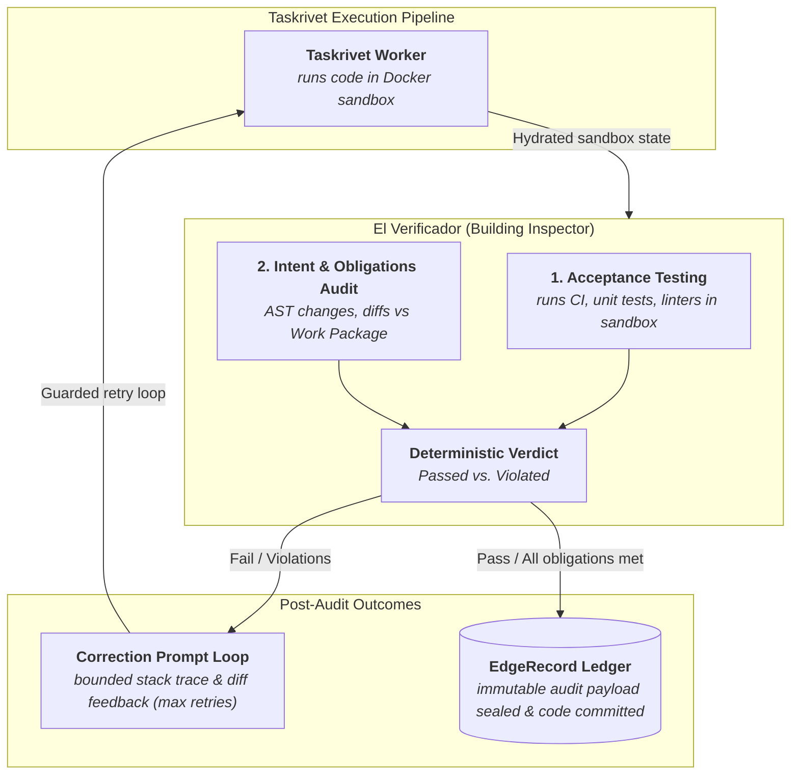

# El Verificador

```text
EEEEE  L        V   V  EEEEE  RRRR   IIIII  FFFFF  IIIII   CCCC   AAA   DDDD    OOO   RRRR
E      L        V   V  E      R   R    I    F        I    C      A   A  D   D  O   O  R   R
E      L        V   V  E      RRRR     I    F        I    C      AAAAA  D   D  O   O  RRRR
EEE    L        V   V  EEE    R  R     I    FFF      I    C      A   A  D   D  O   O  R  R
E      L         V V   E      R   R    I    F        I    C      A   A  D   D  O   O  R   R
E      L         V V   E      R   R    I    F        I    C      A   A  D   D  O   O  R   R
EEEEE  LLLLL      V    EEEEE  R   R  IIIII  F      IIIII   CCCC  A   A  DDDD    OOO   R   R

  >_ Code written is not code committed.
```

[](https://github.com/hamanakam1/el-verificador/actions/workflows/tests.yml)
[](LICENSE)
[](https://www.python.org/)
[](pyproject.toml)
[](https://github.com/hamanakam1/el-verificador/releases)
[](https://github.com/hamanakam1/el-verificador)
[](https://github.com/hamanakam1/el-verificador)
[](https://github.com/hamanakam1/el-verificador/commits/main)
[](https://github.com/hamanakam1/el-verificador/stargazers)
[](https://github.com/hamanakam1/el-verificador/network/members)
[](https://github.com/hamanakam1/el-verificador/issues)
[](https://github.com/hamanakam1/el-verificador/graphs/contributors)
[](https://github.com/hamanakam1/el-verificador/commits/main)

**The building inspector. Independent intent verification and guardrailed feedback routing for the Taskrivet pipeline.**

> *Taskrivet cannot grade its own homework. El Verificador is the gate between "code written" and "code committed".*

---

## Purpose

El Verificador is the autonomous gatekeeper that closes the loop in the Panther → El Destilador → Ticket Board → El Hidratador → Taskrivet → **El Verificador** → EdgeRecord pipeline. It independently audits Taskrivet's work before the Docker sandbox is torn down and code is merged.



## Core Responsibilities

### 1. Independent Acceptance Testing
Taskrivet cannot grade its own homework. El Verificador runs the CI/CD pipeline inside the hydrated Docker container. It executes unit tests, linters, and security scans. It only cares if the container exits with `0` and the tests pass.

### 2. Intent Alignment (The Semantic Diff)
Passing tests aren't enough—the code must solve the user's original problem. El Verificador compares the actual Abstract Syntax Tree (AST) changes and git diffs against the `DistilledWorkPackage` originally generated by El Destilador. *Did the agent actually build the API route, or did it just write `// TODO: Implement route`?*

### 3. The Guardrailed Feedback Loop
If Taskrivet breaks the build, El Verificador does not blindly say "try again". It acts as a precise debugger:

- Captures the exact stack trace, the specific semantic diff, and the failed test output
- Packages this into a highly bounded, strict "Correction Prompt"
- Hands the prompt back to Taskrivet for a retry
- **Crucially:** Enforces a strict iteration limit (`max_retries=3`). If Taskrivet fails three times, the loop is broken, the container is paused, and the ticket is flagged on the Ticket Board for human intervention

### 4. State Commit & Teardown
When the code passes both machine tests and the semantic intent check, El Verificador executes the final logistical steps:

- Commits the code to the target Git branch
- Tears down the Docker containers and releases compute resources back to The Transmission
- Fires a cryptographically secure payload to **EdgeRecord**, immutably logging what was changed, why it was changed, and proof that it passed

## The Complete Autonomous Cycle

1. **Panther:** Captures raw multimodal signals
2. **El Destilador:** Distills noise into a true intent Work Package
3. **Ticket Board:** Human roadmap and durable backlog triage
4. **El Hidratador:** Provisions the local Docker sandbox and DAG
5. **Taskrivet:** Executes the code inside the sandbox
6. **El Verificador:** Audits the execution, manages the retry loop, and commits the state to EdgeRecord

## Screenshots

Every image below is a **real captured CLI run**, replayed into a terminal
window — not a mock-up. The demo repository is a two-commit miniature of the
kind of project Taskrivet would be asked to modify, built and verified for
real. Reproduce the whole set with:

```bash
python scripts/capture_screenshots.py
```

How each image was produced is recorded in
[docs/screenshots/SOURCES.md](docs/screenshots/SOURCES.md).

### A passing verification

Acceptance checks ran, the intent diff was computed, the code was committed:


### A bounded Correction Prompt, handed back to Taskrivet

The exact failing assertion, the lint error, and the semantic diff — bounded,
and addressed to the agent that has to fix it:


### The guardrail: three attempts, then escalation

The retry budget is hard. On exhaustion the loop breaks and the work is flagged
for a human instead of being retried forever:


### A tamper-evident audit trail

Each decision is content-hashed and chained to the previous one, so the record
of *what was decided and why* cannot be quietly rewritten:


## Design Principles

- **Independent by construction** — Never trusts Taskrivet's self-reported status
- **Evidence-first** — Every decision requires concrete proof (test results, AST diff, stack traces)
- **Guardrailed** — Hard iteration limits prevent infinite token-burning loops
- **Fail-safe** — On exhaustion, escalate to humans with full context
- **Auditable** — All decisions logged to EdgeRecord with cryptographic proof
- **Local-first** — Runs on your mesh network, no cloud dependencies required

## Status

**Alpha — the core loop runs; the pipeline is not yet connected.**

Implemented and tested (116 tests green): the data contracts, the Docker sandbox
runner, the AST semantic diff, the guardrailed retry loop, git commit +
teardown, and the hash-chained audit ledger. The verification cycle has run
end-to-end against a real repository — see the screenshots above.

Defects that prevented that from being true are fixed and recorded in
[ROADMAP.md](ROADMAP.md) Appendices B, D, E, F, G, H, I, and J: every
non-dry-run verification crashed on a shadowed method, the primary CLI command
crashed on its JSON serialisation, dry-run checks ran in the wrong directory,
the semantic diff crashed on binary files in the diff, the semantic diff could
not see a rewritten function body, the coverage score measured the wrong
thing, the commit path staged the whole working tree, the escalation path
discarded its evidence, the audit hash did not cover the evidence it claimed
to protect, the retry loop spent its budget on an unchanged repository, the
acceptance contract was hardcoded, the host was a silent fallback for the
sandbox, and **the audit trail was never written at all** — the logger could
not be injected, so every verification ran, decided, and recorded nothing.

`scripts/verify_end_to_end.sh` runs the whole cycle through the CLI in a
temporary directory and prints what was decided and what was recorded:

```bash
=== verify ===
decision          : pass
contract source   : work-package
intent coverage   : 1.0

=== audit chain ===
Audit chain valid: True (1 records verified)
```

**Known gaps, all tracked in [ROADMAP.md](ROADMAP.md):**

- Taskrivet dispatch, Ticket Board escalation, and a canonical EdgeRecord
  receipt do not exist yet. `ESCALATE` is currently a return value, not an
  escalation.
- The intent-coverage score is now measured against the identifiers the goal
  names and is reported with its inputs, but the configured threshold is still
  not enforced: the score has not been calibrated against a population of real
  work packages, and a correct implementation that spells a name differently
  would score below it. It is called out as an operator decision rather than
  done silently.
- The EdgeRecord audit record is written to the verifier's own local ledger
  (`~/.el-verificador/ledger.sqlite`), not to a canonical EdgeRecord receipt.
  The ledger is hash-chained and tamper-evident, but it is not yet the system
  of record.

## What El Verificador gates

El Verificador sits downstream of
[Taskrivet](https://github.com/hamanakam1/taskrivet). Taskrivet does the work;
El Verificador decides whether that work is real.


*Taskrivet's workspace view. Every task carries an objective, acceptance
criteria, a resource scope, and a token budget. The queue shows `READY`,
`RUNNING`, `REVIEW`, `BLOCKED`, and `ACCEPTED` states, and "Accepted outcomes"
counts only work an operator explicitly accepted — activity is not completion.
The ledger behind this screenshot is a synthetic fixture.*


*Failures stay in the record across retries. Each one carries a stable
fingerprint, so a recurring failure groups instead of quietly disappearing.
This is the evidence El Verificador's correction loop is built to answer.*

Screenshot provenance is recorded in
[docs/screenshots/SOURCES.md](docs/screenshots/SOURCES.md).

## Quick Start

```bash
# 1. Create config
python -m el_verificador config --init

# 2. Verify a DistilledWorkPackage (dry-run: no Docker/git/EdgeRecord writes)
python -m el_verificador verify \
  --work-package path/to/work_package.json \
  --repo /path/to/repo \
  --base HEAD~1 \
  --head HEAD \
  --dry-run

# 3. Check the audit trail
python -m el_verificador audit --verify-chain
```

### Where the checks run

Acceptance checks run inside the Docker sandbox, using the contract the work
package declared when it declared one, and the configured default otherwise.
A work package can carry its own commands:

```json
{
  "id": "dwp-1",
  "true_goal": "Implement the Go handler for the upload endpoint",
  "acceptance_commands": ["go test ./...", "go vet ./..."]
}
```

or state them in a fenced code block inside its acceptance criteria. Which
contract produced a decision is recorded with the result.

When there is no sandbox — Docker is not running, or `--dry-run` is set — the
checks are **not** run on your machine by default, because the repository
under test contains code the agent wrote, and running its test suite there
executes that code with your credentials, in your working tree, with your
network. A `conftest.py` is arbitrary code, and pytest imports it before the
tests run.

The check is refused with an explanation, and the verification fails closed.
If you trust the repository and accept that its test code will run on your
machine, say so:

```bash
python -m el_verificador verify ... --allow-host-execution
```

or set `allow_host_execution: true` in the configuration. Start the Docker
daemon to run the checks in the sandbox instead.

## Verification Cycle

| Stage | What happens |
|-------|--------------|
| Acceptance testing | Unit tests, lint, security scans run inside the hydrated Docker sandbox |
| Intent alignment | AST/git diff compared against the `DistilledWorkPackage` true goal |
| Correction loop | Failed runs produce a bounded Correction Prompt to Taskrivet (`max_retries=3`) |
| Exhaustion | Loop breaks; ticket flagged for human intervention with full context |
| Pass | Code committed, sandbox torn down, audit payload fired to EdgeRecord |

## Documentation

| Document | What it covers |
|----------|----------------|
| [ROADMAP.md](ROADMAP.md) | The long-term build plan: verified defect list, target architecture, six phases with exit gates, integration contracts, risk register, and the decisions that need an operator |
| [SPEC.md](SPEC.md) | The system specification |
| [AGENTS.md](AGENTS.md) | Contributor conventions for agents and humans |
| [CONTRIBUTING.md](CONTRIBUTING.md) | How to contribute |
| [SECURITY.md](SECURITY.md) | Security posture and reporting |
| [CHANGELOG.md](CHANGELOG.md) | Release history |
| [docs/screenshots/](docs/screenshots/) | The captured runs shown above |
| [docs/screenshots/SOURCES.md](docs/screenshots/SOURCES.md) | How each screenshot was produced, and how to regenerate it |
| [docs/examples/](docs/examples/) | The demo repository the CLI screenshots verify |
